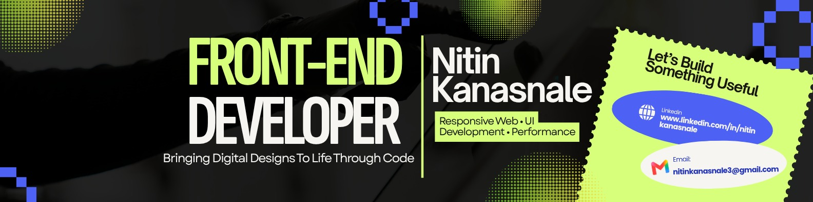

  

 

MCA student @ Presidency University, Bengaluru.

I turn ideas into interactive web experiences.  
Currently focused on JavaScript, frontend development, and building things that work.

[LinkedIn](https://linkedin.com/in/nitinkanasnale) · [Email](mailto:nitinkanasnale3@gmail.com)

### Things I've Built

| Project | Description | Link |
|---|---|---|
| **Simon Game** | Memory game with dynamic sequences | [View ↗](https://github.com/nitinkanasnale93/SimonGame) |
| **Music Player** | Spotify-inspired browser music player | [View ↗](https://github.com/nitinkanasnale93/spotify-project) |
| **MANGO3** | Chat management web application | [View ↗](https://github.com/nitinkanasnale93/MANGO3) |

### My Toolkit

`HTML` `CSS` `JavaScript` `Git` `GitHub`

---

### What I'm up to

<!--START_SECTION:activity-->
<!--END_SECTION:activity-->

---

*Less talking. More building.*
